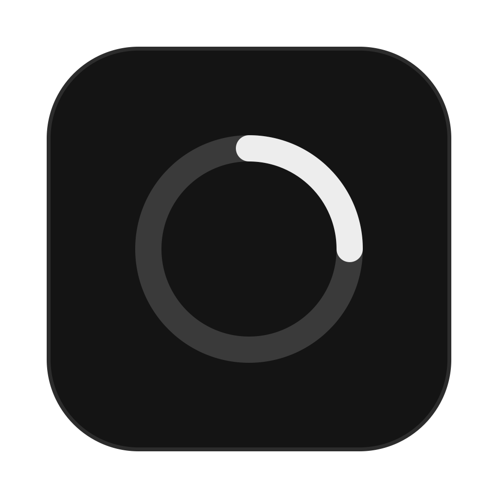
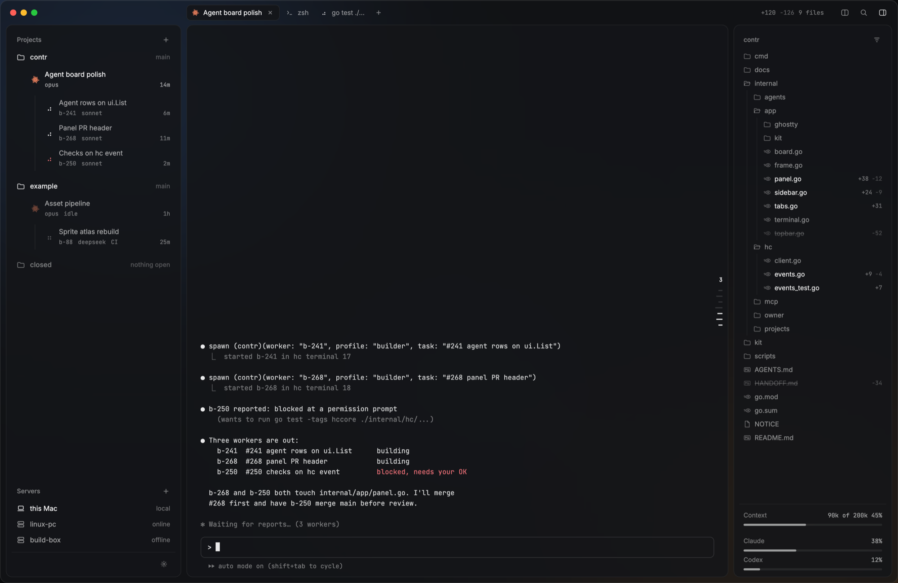

<p align="center">
  
</p>

<h1 align="center">contr</h1>

<p align="center">
  Run and watch many coding agents at once, in one native macOS window.
</p>

<p align="center">
  
</p>

> **Work in progress.** contr changes every day. Expect missing parts and
> breaking changes until a 1.0 release.

contr is a native macOS client for herdr-core (`hc`). It is written in Go and
uses MyGo's native UI, in a frosted glass window with Dark and Light themes.

- **Left:** your projects, each with its orchestrator and the workers it
  started, and their state. Servers and Settings are at the bottom.
- **Middle:** the terminal of the selected agent, with its tabs and search.
  A notch at the top collects the questions, to-dos and blocked prompts of
  all agents, so you can answer them from any terminal.
- **Right:** the file tree of the agent's worktree with each file's changes,
  the agent's context and the Claude and Codex plan usage.

## Requirements

- macOS on Apple silicon (arm64).
- `hc` (herdr-core), installed. contr starts it when needed.

## Install

```sh
scripts/bundle.sh      # builds dist/bundle/contr.app with `go tool mygo build`
scripts/install.sh     # installs to /Applications and links `contr` in ~/.local/bin
```

The Claude usage meter reads Claude Code's status line. contr does not edit
Claude Code's settings, so set the `statusLine` command in
`~/.claude/settings.json` yourself. Put `contr statusline --` before the
command you use now; contr gives it the same input and prints its output:

```json
"statusLine": {
  "type": "command",
  "command": "~/.local/bin/contr statusline -- <your current command>"
}
```

With no status line of your own, use `contr statusline` alone. Tools that
rewrite `statusLine` can remove contr again. Then the meter shows
"no data yet".

## Build and check

Go downloads the toolchain that `go.mod` names.

```sh
go run ./cmd/contr     # opens the window
scripts/check.sh       # gofmt, vet, tests with -race, build without cgo
```

The Rust and GPUI app is at tag `rust-final`.

## Docs

- `docs/DESIGN.md`: the UI
- `docs/DECISIONS.md`: decisions
- `docs/PORT-PLAN.md`: how the Go port was built
- `docs/BENCHMARKS.md`: the measurements behind the move to Go
- `AGENTS.md`: rules for agents
