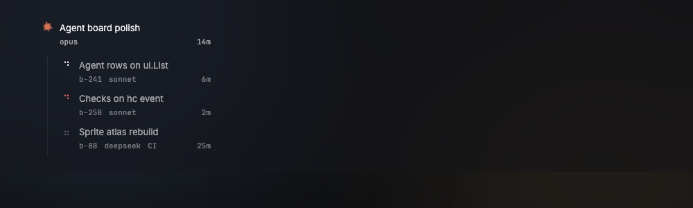
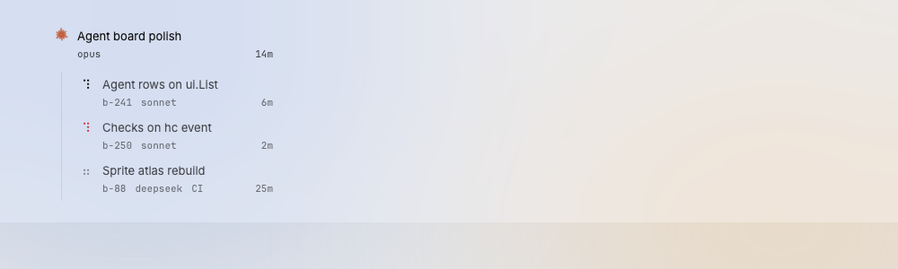

# AgentRow

A two-line sidebar row for one agent: the orchestrator sits at the top of its project, and its workers list under it on a thin rail.

Design system page: component AgentRow. Shared rules: [README.md](README.md).

| Dark | Light |
|---|---|
|  |  |

## Anatomy

| Part | Value |
|---|---|
| Row | orchestrator padding `7px 10px`, worker padding `5px 10px`, gap `space-10`, radius `radius-8` |
| Leading | Claude glyph (orchestrator; grey `ink-45` for a Claude session that does not orchestrate, D191) or dot StatusGlyph (worker) |
| Line 1 | title in `body`, `ink-60`; one line, ellipsis. A worker shows its issue title, else its task (the terminal title); an orchestrator its name |
| Line 2 | mono `meta` (11px), `ink-42`, items `space-10` apart: worker name, model and effort, then the age at the right ("b-241  sonnet medium  6m"). An orchestrator shows its role in place of the name: "2 workers", or "orchestrator" with no workers yet; a Claude session that does not orchestrate shows none (D191) |
| Indent | the orchestrator row sits 16px in from its project row (D169) |
| Item badge | orchestrator rows with open items (D240): at the right of line 1, `space-8` from the title; height 16px, min width 16px, padding `0 5px`, radius 8px, fill `blocked`; the number in `badge` (mono 10.5px, 700), `ground` |
| Kids rail | workers indent a further 17px with 9px padding; a 1px `rail` line on the left |

## States

- **Default.**
- **Hover:** fill `hover`.
- **Selected (D249):** fill `selected` and the 1px `shadow-selected` ring, as the selected tab. Title turns `ink-100`, line 2 `ink-62`. The tabs and the right panel follow the selected row.
- **Needs you (D249):** a worker blocked on a menu, or in error. The glyph turns `blocked`; the row has fill `blocked-fill` and a 1px inner ring `blocked-line`, also when it is selected; the title is `ink-100`. Line 2 says why in place of the name, model and CI: "needs you ·" in `blocked`, then the block kind (`permission`, `question` or `auth`) in the line 2 ink, then the age at the right. When the kind is not known (an error, or another kind), line 2 is "needs you" alone and the age. An orchestrator keeps its look: its item badge counts the menu (D240).
- **Items for you (D240):** an orchestrator whose project has open items
  that belong to it or its workers shows the item badge with their number.
  On an arrival (the number goes up) the badge springs (1.25 at 120 ms, 0.94
  at 260 ms, 1 at 400 ms) and a `blocked` glow (`0 0 12px 3px` at 0.55)
  fades out by 2.08 s; then it is still. It goes at 0. With Reduce Motion
  the number changes at once.
- **Waiting on CI:** idle glyph; line 2 adds "CI" after the model (D145). The data is the checks of the worker's pull request: a live worker that is not working, whose PR has unfinished checks.

## Behavior

- The orchestrator row is first under its project. Its workers list under
  it on the rail.
- Click selects the agent: the title bar shows its tabs, the terminal
  shows its main terminal, the files panel shows its worktree. The terminal
  takes the keyboard focus, also on a click on the row that is already
  selected, so the owner can type at once (D188).
- Line 1 of a worker is the title of its issue (D174); with none known, its
  task: the terminal title without its status glyph, when it is usable (not
  a path or a program name); else the worker name (D169).
- Line 2: worker name, model, age. The name is left out when line 1 shows
  it, and for an orchestrator. The model is the `--model` of the agent's
  profile, else the `--model` of the terminal's own command line (D169), else
  the model that Claude Code's status line reported for the terminal (D174).
  The kit's Stop hook labels each Claude Code session's terminal with its
  model and effort (`contr.model`, `contr.effort`), and these labels come
  after the command line and before the status line, so a session shows
  them after its first turn with no status line set up (D189). The effort
  follows the model, from the same places in the same order ("opus high").
  The issue id is in the accessibility label only. The age is the time since the last hc event for the terminal,
  as "now" (under a minute), "6m" or "2h".
- Ages (D137, O10): one shared 1-minute timer moves them. It runs only
  while the window is visible and an age is on screen (an agent row of an
  open project has one). It stops when the window hides or no age shows.
  Ages also move on every state change, because each build reads the clock.
- Context menu: Interrupt, Stop, Close, Open PR. Stop keeps the ended
  terminal; Close also removes it, so the row goes (D219). They call the agent source
  (`internal/agents`) off the UI thread; Open PR opens the pull request in the
  browser (`gh pr view --web`), never in the PR pane (D127), and is off while
  the agent has no pull request. A failure shows in the status message. Stop asks for no second click: the menu choice is the
  confirmation.
- Item badge (D240): it counts the open questions, to-dos and blocked menus
  of the project that the notch counts. An item belongs to the terminal
  that asked (the blocked worker, or the `coordinator` of the question or
  to-do), and so to the orchestrator that terminal sits under; an ended
  worker counts for its parent. An item of no known terminal goes to the
  first orchestrator of the project, as a worker of no orchestrator does.
  So the badges of a project add up to the notch count. While the questions
  file is broken (D146) no badge shows.
- Icon column (D128): an orchestrator with open items shows a still 6px
  `blocked` dot at the top right of its glyph; the badge does not fit. A
  selected agent has the `selected` fill and ring; a worker that needs the
  owner has `blocked-fill` and the `blocked-line` ring (D249).
- A selected agent that is gone leaves the selection.
- The project row shows the selection for the project itself, and while the
  project is folded; an open project shows it on the agent row.

## Data

- `internal/agents` (list, watch) through `Window.Update`.

## Keys and focus

- ↑ ↓ move the selection over project and agent rows; ⏎ focuses the terminal (D145). They work in the icon column too.
- `⌘⌥↑` and `⌘⌥↓` select the agent row above or below from anywhere in the window; project rows are skipped and the terminal takes the focus. While ⌘ is held, those two rows show `⌥↑` and `⌥↓` key chips on their status glyph (KeyHints.md).

## Edge cases

- A worker with no usable title: line 1 is its name; line 2 starts with the model.
- Model unknown: the age still sits at the right of line 2, under the title.
- An ended worker: removed (D112).
- A worker of another orchestrator in the same project: under its own
  orchestrator.

## Accessibility

- Label: "<title>, <state>, <issue>, <model>". A worker that needs the
  owner adds its block kind when known (", permission"). An orchestrator with open
  items adds ", 2 items for you" ("1 item for you"). The badge is "items
  for you"; the dot of the icon column "items for you dot".

## Tokens

`hover`, `selected`, `shadow-selected`, `blocked-fill`, `blocked-line`, `rail`, `ink-100`, `ink-62`, `ink-60`, `ink-42`, `space-8`, `space-10`, `radius-8`, `body`, `meta`, `badge`, `blocked`, `ground`.

## Build in MyGo

- A `kit.Row` in the same `ui.List` as the projects. The two lines are `Text(...).NoWrap().Ellipsis()`.
- Data: `internal/agents` (list, watch). Watch events reach the view through `Window.Update`.
- Ages: `AgeClock`, one timer (D137). It starts and stops from `SpacesList`
  (an age shows) and the window visibility.
- Keys: ↑ ↓ move the selection, ⏎ focuses the terminal.
- `.ContextMenu(...)`: Interrupt, Stop, Close, Open PR.
- Item badge: `kit.Arrivals` per orchestrator address, `kit.BadgeAttention`
  with MyGo `Keyframes` on the badge, asked only while the effect plays
  (D240).

## Do and do not

**Do**

- Put the orchestrator first, whatever its state.
- Keep line 2 short: name, model, age.

**Don't**

- Do not show ended workers: stop removes them.
- Do not show the full task text: the title is enough.

## Tests

- View: orchestrator and worker rows, selected, needs you, waiting on CI.
- View: the fill and ring of a selected row and of a needs-you row, in rows
  and in the icon column; line 2 of a needs-you worker for each block kind
  and for none; a blocked orchestrator keeps its line 2 (D249).
- View: click selects the agent and the tabs change.
- View: badge count per orchestrator (its own items and its workers'),
  gone at 0, none on worker rows, a dot in the icon column; the badge moves
  on an arrival and asks for no frame after it (D240).

## Replaces

- The Agents section of `agents.go` (D54 line 2, state groups).

