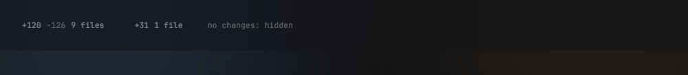
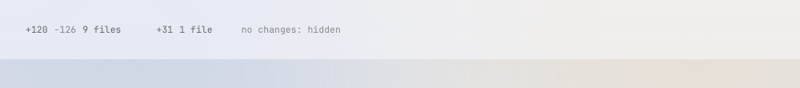

# DiffSummary

A mono button in the title bar that counts the changed lines and files of the selected agent and opens the Review view.

Design system page: component DiffSummary. Shared rules: [README.md](README.md).

| Dark | Light |
|---|---|
|  |  |

## Anatomy

`+120  −126  9 files`, in style `value` (mono 11.5/16):

- Added count and file count: `ink-42`.
- Removed count: `ink-30`.

The counts sit `space-8` apart. The button has padding `4px 8px` and radius `radius-7`.

## States

- **Default:** as above.
- **Hover:** fill `hover`.
- **No changes:** the button hides.
- **Only additions:** the removed count hides.

## Behavior

- Click opens the Review view (D37) on the selected agent. A click on a
  tab shows the terminal again.

## Data

- The counts are the totals of the file tree (FileTree.md, D131): `Repo.Changes`
  of the selected agent's worktree, else the project folder. That is the work
  tree against the merge base with `main` (committed, staged and unstaged
  changes) plus the new files that git does not ignore. Other agents'
  branches do not count. The title bar total and the tree always agree.
- One read and one watch serve both. The tree reads on a goroutine and reads
  again on a change of the work tree (`mygo.WatchFiles`, D131). No timer.
  The title bar keeps the tree pointed at the folder, so the counts stay
  current while the files panel is hidden.

## Keys and focus

- Space and ⏎ when focused.

## Edge cases

- git fails or the folder is not a repo: hide the button and log the error.
- No changes: hide. Only additions: hide the removed count.

## Accessibility

- Label: "120 lines added, 126 removed, 9 files. Open review".

## Tokens

`value` type style, `ink-42`, `ink-30`, `hover`, `radius-7`, `space-8`.

## Build in MyGo

- `ButtonBase` with three `Text` runs; the counts come from `kit.Counts`. Do not write a second counter.
- Data: the file tree's changes (`FileTree.Summary`, `review.Total`). The summary has no read and no watch of its own.
- Click opens the Review view (`editor.DiffView`).

## Do and do not

**Do**

- Use the minus sign "−" (U+2212), not a hyphen.

**Don't**

- Do not color the counts green or red here: the diff colors are only for the diff view.

## Tests

- View: counts render; zero hides; git error hides.
- Unit: a repo with a committed change, an uncommitted change, an untracked file and a second agent's branch gives the same totals in the summary and in the tree rows.
- Unit: the label text for each case.

## Replaces

- The `Review` button of the v0.2 top bar.
