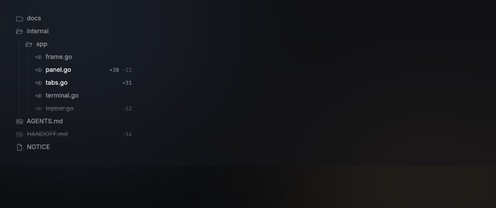
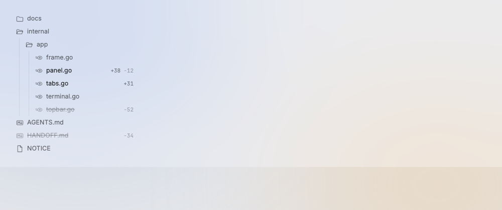

# FileTree

The files panel shows the project tree; changed files show their +/− line counts.

Design system page: component FileTree. Shared rules: [README.md](README.md).

| Dark | Light |
|---|---|
|  |  |

## Anatomy

| Part | Value |
|---|---|
| Head | "Files", under the agent's todos and artifacts ([SessionPanel.md](SessionPanel.md), D197); the filter button at the right uses the `filter` icon: three lines, long to short |
| Row | height `file-row-height` (26px), padding `0 10px` (D228), gap `space-7`, radius `radius-6` |
| Icon | `folder`, `folder-open`, `file-go`, `file-md`, `file` at 15px, `ink-38` |
| Name | `row-small` (12.5px), `ink-50`; ellipsis |
| Counts | mono 11px, `space-6` apart: added `ink-40`, removed `ink-24` |
| Guides | each level indents `space-16` plus `space-4` (D228), with a 1px `hairline` on the left |

## States

- **Default:** name `ink-50`.
- **Hover:** fill `hover`.
- **Changed:** name `ink-90`, counts show.
- **New:** name `ink-90`, "+N" only.
- **Deleted:** name `ink-24` with a line through it; icon and "−N" `ink-22`.
- **Filter on:** the filter icon button in the panel head shows only changed files.

## Behavior

- The tree of the selected agent's worktree, else the project folder.
- Changed files show +/− counts; the filter button shows changed files
  only.
- Click opens the file in the Review view; ⌘-click reveals it in Finder.

## What "changed" means

- A file is changed when the work tree differs from the merge base of `main`
  and `HEAD`: committed, staged and unstaged edits, deleted files and new
  files that git does not ignore (`review.Repo.Changes`). A deleted file is
  put back in its folder, struck through. A new or deleted file shows one
  count; a binary file shows none.
- With the filter on, the tree is made from the changed paths only and its
  folders start open.

## Data

- `internal/review` on a goroutine; `mygo.WatchFiles` on the folder starts a
  new read. Big folders: read on open of a folder, not all at once.
- Respect `.gitignore`.

## Keys and focus

- ↑ ↓ move, ← → close and open, ⏎ opens.

## Edge cases

- No folder (no project open): one line, "Files of the open project show here" (`small`,
  `ink-42`), in place of "No folder" (D255). A narrow panel cuts it with an ellipsis.
- Not a git repo: no counts.
- A folder with thousands of files: the list is virtual (`ui.Tree`).

## Accessibility

- Tree roles from `ui.Tree`; labels with the counts.

## Tokens

`file-row-height`, `radius-6`, `space-4`, `space-7`, `space-10`, `space-16`, `hover`, `hairline`, `ink-90`, `ink-50`, `ink-40`, `ink-38`, `ink-24`, `ink-22`, `row-small`.

## Build in MyGo

- `ui.Tree` with `TreeItem`s (the row is a `TreeItem` with an empty label;
  the icon, name and counts are added to it, and the guides are drawn over
  it). The mock has no disclosure arrow: a folder shows `folder` or
  `folder-open`. `TreeItem` always builds an arrow, so the tree sits in
  `ui.Themed` with `TextMuted` clear (the arrow is not seen) and
  `SurfaceHover` set to `hover`, and the row takes back the room of the
  arrow with a negative start margin (D170). It gives the keys (← → open and close, ↑ ↓ move) and the screen-reader roles.
- Counts: `kit.Counts`.
- Data: `internal/review` on a goroutine; `mygo.WatchFiles` triggers a new read.
- Click opens the file in the Review view; ⌘-click reveals it in Finder.

## Do and do not

**Do**

- Sort folders first, then files, by name.

**Don't**

- Do not color file names by state: weight and ink do it.

## Tests

- Unit: tree build and counts on a temp repo.
- View: filter on shows changed files only; deleted style; no folder shows the D255 line.

## Replaces

- The v0.2 right panel (board and worker). The right panel shows only files (D122).
