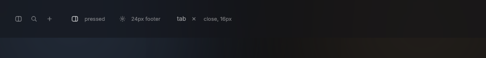
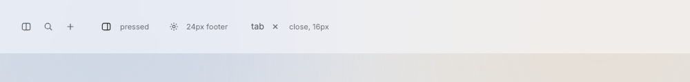

# IconButton

A square button with one 16px line icon; it shows its name and shortcut in a tooltip.

Design system page: component IconButton. Shared rules: [README.md](README.md).

| Dark | Light |
|---|---|
|  |  |

## Anatomy

| Part | Value |
|---|---|
| Box | `icon-button` (28px) square; 24px in panel footers; radius `radius-8` |
| Icon | 16px drawing shown at 14px, stroke 1.2–1.4, `currentColor` = `ink-50` |

## States

- **Default:** icon `ink-50`, no fill.
- **Hover:** fill `hover-strong`, icon `ink-100`.
- **Pressed (toggle on):** icon `ink-85`, no fill.
- **Focus (keyboard):** 1px ring in `focus-ring`, 2px offset, radius `radius-8`. This is the focus ring for every button.
- **Disabled:** not in the design. If needed, use icon `ink-22` and no hover.

## Behavior

- Click runs the action. A toggle button keeps its pressed state from the model, not from the click.

## Data

- None.

## Keys and focus

- Space and ⏎ press it when focused. Its window shortcut, if any, is in the tooltip, and in a key chip on its bottom right corner while ⌘ is held (KeyHints.md).

## Edge cases

- Disabled is not in the design: use `ink-22`, no hover, no tooltip key.

## Accessibility

- Label required. Toggles report pressed.

## Tokens

`icon-button`, `radius-8`, `hover-strong`, `focus-ring`, `ink-50`, `ink-85`, `ink-100`.

## Build in MyGo

- `ButtonBase` with `ui.Icon(svg)`; the icon draws in the text color, so the states only change the text color.
- Toggle buttons (Hide files, Show changed files only): `ToggleBase`.
- The ring is drawn by the button (`FocusRing(false)` and `DrawOver`): MyGo's own ring is 2px wide, 1px away.
- Give each button a screen-reader label and `.Tooltip("Search  ⌘F")`.

## Do and do not

**Do**

- Use the icons in the Icons asset group.
- Always set a label.

**Don't**

- Do not put text in an icon button.
- Do not use a filled icon.

## Tests

- View: hover, pressed and focus states; the tooltip text has the key.

## Replaces

- The icon buttons in `titlebar.go`, `panel.go` and `statusbar.go`.
