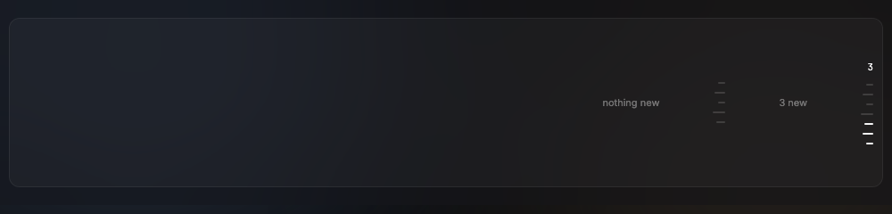
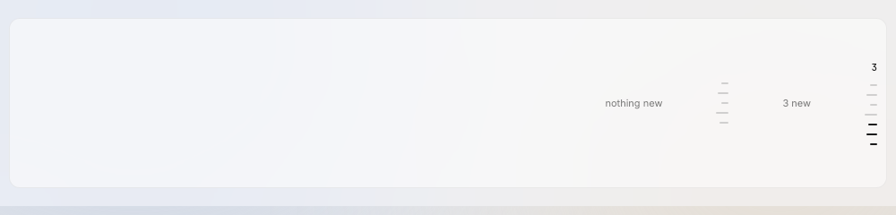

# Outline

A column of short ticks on the right edge of the orchestrator terminal, centered on the height; each tick is one message from the orchestrator, and new ones are `ink-100` with their count on top.

Design system page: component Outline. Shared rules: [README.md](README.md).

| Dark | Light |
|---|---|
|  |  |

## Anatomy

| Part | Value |
|---|---|
| Column | right edge of the terminal, inset 10px, centered on the height; ticks right-aligned, gap 9px |
| Tick | height `tick-height` (2px), width 8–14px by message length, `tick`, radius `radius-1` |
| New tick | `ink-100` |
| Count | mono `count` (11/14/500), `ink-100`, 3px above the ticks; only when there are new ticks |

## States

- **Nothing new:** all ticks `tick`; no count.
- **New messages:** the ticks since the owner last looked at this terminal are `ink-100`; the count shows how many.
- **Hover:** the tick grows to 20px and the OutlineCard shows at its left.
- **Click:** the terminal scrolls to the message; that tick and those before it become read.

## Behavior

- One tick per orchestrator message pinned for the owner (`pin_for_owner`).
- "New" means after the last time this terminal had the focus. The terminal
  has the focus while it is selected and the window has the focus. A message
  that comes while the owner looks is not new. A message that came while away
  stays new until the owner leaves again or clicks it. A terminal never seen
  starts with what is pinned when contr starts as old.
- Click jumps to the message. hc has no scroll-to (DESIGN.md data table):
  until a source exists, click opens the OutlineCard and marks the tick
  read.

## Data

- Pins from the owner store; focus times kept in memory per terminal.

## Keys and focus

- ⇥ reaches the ticks; ↑ ↓ move between them; ⏎ opens.

## Edge cases

- More ticks than fit: show the newest that fit.
- No pins: no column.

## Accessibility

- Each tick is a button labeled with the headline and "new" when new.

## Tokens

`tick`, `tick-height`, `radius-1`, `ink-100`, `count`.

## Build in MyGo

- A small custom widget: a column of `ButtonBase` ticks (each label: the headline). Hit area 20×10px for each tick, even if the tick is 2px high.
- Hover card: `TooltipBase` with placement left (see OutlineCard).
- Data: the orchestrator's pinned messages (`pin_for_owner`); "since you left" = after the last time the terminal had focus.
- Only the orchestrator terminal shows the outline.

## Do and do not

**Do**

- Keep the ticks short and quiet: the count says that something is new.

**Don't**

- Do not show more than about 40 ticks; group older ones.
- Do not use red for new ticks.

## Tests

- View: ticks render; new count; focus marks them read.
- View: only the orchestrator terminal has the column.

## Replaces

- The removed pin bar.
