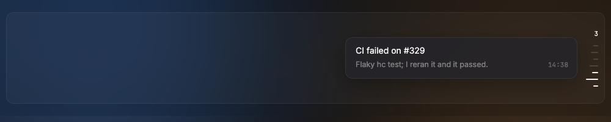
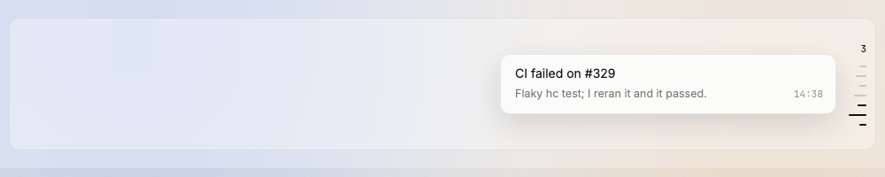

# OutlineCard

The card that shows at the left of a hovered outline tick: the message headline, one detail line, and the time at the bottom right.

Design system page: component OutlineCard. Shared rules: [README.md](README.md).

| Dark | Light |
|---|---|
|  |  |

## Anatomy

| Part | Value |
|---|---|
| Card | width `outline-card-width` (380px), padding `12px 14px 13px 16px`, gap 5px, radius `radius-12` |
| Glass | `glass-float`, line `float-line`, `shadow-float` |
| Headline | 14px, `ink-100` |
| Row | detail 12.5/18, `ink-48`; time mono 11px, `ink-48`, at the bottom right, `space-16` from the detail |

## States

- **Shows** on tick hover or focus; hides on leave or Esc.
- **One at a time.**

## Behavior

- Shows the headline, one detail line and the time of the hovered tick.
- A tick of the chat (D270): the headline is the first words, at most two lines; the detail line is the kind ("Decision", "Warning", "Done", "Not verified", "You", "Needs you", "Pinned", "Question"). A sent prompt has no time: none shows.

## Data

- The pin of the tick.

## Keys and focus

- Esc hides it when the tick has the focus.

## Edge cases

- A long headline or detail: ellipsis on one line each; a chat tick's headline ends with an ellipsis on its second line.

## Accessibility

- Tooltip text = headline, detail and time.

## Tokens

`outline-card-width`, `glass-float`, `float-line`, `shadow-float`, `radius-12`, `space-16`, `ink-100`, `ink-48`.

## Build in MyGo

- `TooltipBase` on each tick, placement left. MyGo fixes its delay at 0.6s for
  the pointer (at once for the keyboard focus), so the card does not wait
  150ms. A click hides a tooltip, so the outline keeps the card a click opened
  until the pointer and the focus leave, or Esc.
- Lines with `Text(...).NoWrap().Ellipsis()`.

## Do and do not

**Do**

- Use 24-hour time "14:38".

**Don't**

- Do not add buttons to the card: click the tick to jump.

## Tests

- View: shows on hover and focus, hides on leave; one at a time.

## Replaces

- Nothing.
