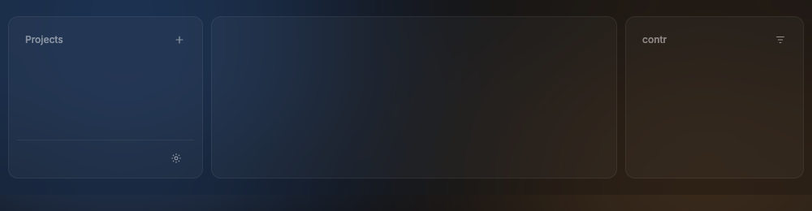
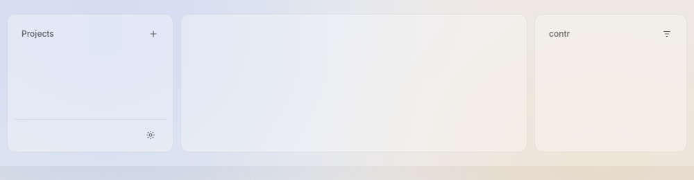

# Panel

A panel is a rounded area inside the window glass: the sidebar, the terminal and the files panel are panels. Only the terminal is drawn as a box, the stage; the sidebar and the files panel are wings on the glass (D250).

Design system page: component Panel. Shared rules: [README.md](README.md).

| Dark | Light |
|---|---|
|  |  |

## Anatomy

| Part | Value |
|---|---|
| Box | the stage (terminal): fill `stage`, line `panel-line` (1px), radius `radius-12`, padding `12px 10px 10px` inside the line. A wing (sidebar, files): no fill and no line; padding 1px more on each side, so its content sits where it sits on the stage (D250) |
| Head | row: name in `label` style (12px/500), `ink-45`, fills the row; icon buttons or a switch at the right (the files panel: Changed \| All, D264); padding `2px 4px 4px 10px` |
| Footer | no line on top (D258): `space-6` above the footer row; 24px icon buttons at the right |

## States

- **Default.**
- **Focused panel:** no change. Focus shows on the focused row or terminal, not on the panel.

## Behavior

- A panel only draws its box, head and footer. Its content scrolls inside
  it (`ui.Scroll`); the head and footer stay.

## Data

- None.

## Keys and focus

- None of its own.

## Edge cases

- A head name too long for the width: ellipsis.

## Accessibility

- The panel is a group named by its head text.

## Tokens

`stage`, `panel-line`, `radius-12`, `space-12`, `space-10`, `label`, `ink-45`.

## Build in MyGo

- A plain container view with `Background`, `Border` and `CornerRadius`; there is no MyGo widget to wrap. `kit.PanelOpts.Stage` picks the stage; without it the panel is a wing.
- The panel head: a row with `Text(...).SingleLine()` (it cuts with an ellipsis; `NoWrap` keeps the line whole) and IconButtons.
- Put the panels in `ui.Split` (see Window).

## Do and do not

**Do**

- The head text may differ from the panel name (`Title`): the files panel shows the project name and stays the group "Files".
- Keep head names short and lower-case where they are names (project name "contr").

**Don't**

- Do not put a panel inside a panel.
- Do not add shadows to panels.

## Tests

- View: head text and icon buttons render; a long name clips; the stage draws its fill and line, a wing draws neither and keeps the content inset.

## Replaces

- The v0.2 card style of the terminal and the panel (`bg.card`, `line`).
