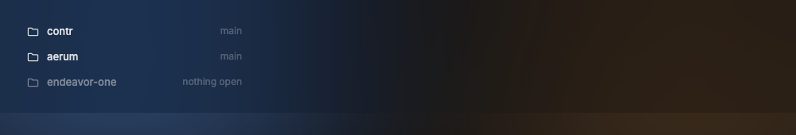
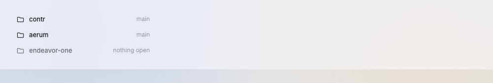

# ProjectRow

A sidebar row that names a project; the agents of the project list below it.

Design system page: component ProjectRow. Shared rules: [README.md](README.md).

| Dark | Light |
|---|---|
|  |  |

## Anatomy

| Part | Value |
|---|---|
| Row | height `row-height` (30px), padding `0 10px`, gap `space-10`, radius `radius-8` |
| Icon | `folder` outline icon at 15px, `ink-88` (`ink-100` selected) |
| Name | `body` (regular), `ink-88` |
| Meta | `small` (12px), `ink-48`, right side: branch, or "nothing open" |

## States

- **Default.**
- **Hover:** fill `hover`.
- **Empty project:** name `ink-48`, icon `ink-30`, meta "nothing open", no `+`; it is a stored project with no terminal.
- **Groups:** a project row after the first has 12px of air above it (D171).
- **Collapsed:** the agent rows hide.

## Behavior

- One row per open project; stored projects with no terminal show as
  empty (D116).
- Click selects the project's orchestrator, else the project (the main
  checkout, or the folder of an empty project).
- A click on the project that is already selected folds or opens it. The
  icon set has no chevron yet, so the row shows no fold mark; the state is
  in the screen-reader label (expanded). A folded project hides its agent
  rows, which sit under it in the same list (#344).
- An empty project has no `+` on its row (D171). With the list focused and
  the key cursor on an empty project, the menu key opens its menu; Enter
  starts nothing (D174).
- Each project row has a context menu (D219, D291): "New orchestrator" while
  the project has no orchestrator, "New terminal", a separator, "Close all
  agents" while it has agents, and "Close project". The two starts run in the
  project's folder (main checkout, else its first worktree, else the stored
  folder), as the `+` menu and New tab do. "Close all agents" stops each
  agent of the project and removes its terminal, also an ended one, with no
  second click. "Close project" takes the project out of the sidebar and
  shows the toast "<name> closed" with Undo (D207); it stops nothing, and
  Open projects brings it back. The menu key opens the menu of the project
  under the key cursor.
- A click on an empty project selects it. The empty terminal then shows
  "New orchestrator" and "New terminal ⌘T" for that project, and ⌘T opens
  the terminal there (D291).
- Empty projects sit after the projects with agents; the others keep the
  dragged order (D174).
- The Projects head has one `+` button. Its menu has "New orchestrator" and
  "Open projects" (D171). The icon column keeps both as buttons.

## Data

- `internal/projects` (order, hidden, recent) and the hc terminals.
- Branch from git on a goroutine; read again on a file watch of `HEAD`.

## Keys and focus

- ↑ ↓ move; ⏎ focuses the terminal (D145). A key never folds a project. ← fold and → open are not built yet.
- `⌘⌥←` and `⌘⌥→` select the project before or after the open one from anywhere in the window, around the ends, as a click on its row does (D248). Hidden projects are skipped; with one project they do nothing. While ⌘ is held, the row before shows `⌥←` and the row after `⌥→` on its folder icon; with two projects the other row shows `⌥→` (KeyHints.md).

## Edge cases

- No projects (D255): in place of the rows, 20 below the Projects head, "No projects yet"
  (`label`, `ink-64`) and, 10 below, the plain button "Open a project ⌘O": text `ink-88`
  (`small`), the key in `kbd` `ink-48`, no fill and no border, 28 high, radius 8; on hover the
  fill `hover` of a plain row. Its text lines up with "No projects yet" (the button sits its
  12 of padding to the left). The one filled button of an empty window is the terminal's. It
  opens the projects modal, as ⌘O does. It shows only when the stored projects are read and
  no git scan runs. The icon column (D128) shows nothing here: its folder button is the way
  in. A narrow sidebar cuts the label with an ellipsis; the key stays.
- No branch (detached or not git): meta shows the short commit or nothing.
- A long name: ellipsis; the meta keeps its width.

## Accessibility

- Tree item, expanded state, label = name and branch.

## Tokens

`row-height`, `radius-8`, `space-10`, `space-12`, `hover`, `ink-88`, `ink-100`, `ink-48`, `ink-30`, `body`, `small`.

## Build in MyGo

- One `ui.List` holds the projects and their agents; each row is a `kit.Row`. Do not use `ui.Sidebar`: it shows the selection in the accent color.
- Open and close a project group with `CollapsibleBase`, or keep a collapsed set in the list state.
- Reorder projects by drag with `ListState.Reorder`; store the order with `internal/projects`.
- `.ContextMenu(...)`: New orchestrator, New terminal, Close all agents, Close project (D219, D291). Open in Finder and Remove wait.

## Do and do not

**Do**

- Show the projects in the owner's order, empty ones last.

**Don't**

- Do not show a count badge on the project row.

## Tests

- View: empty project style and menu; no projects shows the D255 text and button, and not
  while the projects load or a scan runs; air between groups; the `+` menu; fold and open; drag order writes the store.
- e2e: select a project on a scratch core and see its orchestrator selected.

## Replaces

- The project rows of `spaces.go` and the worktree rows (D52).
