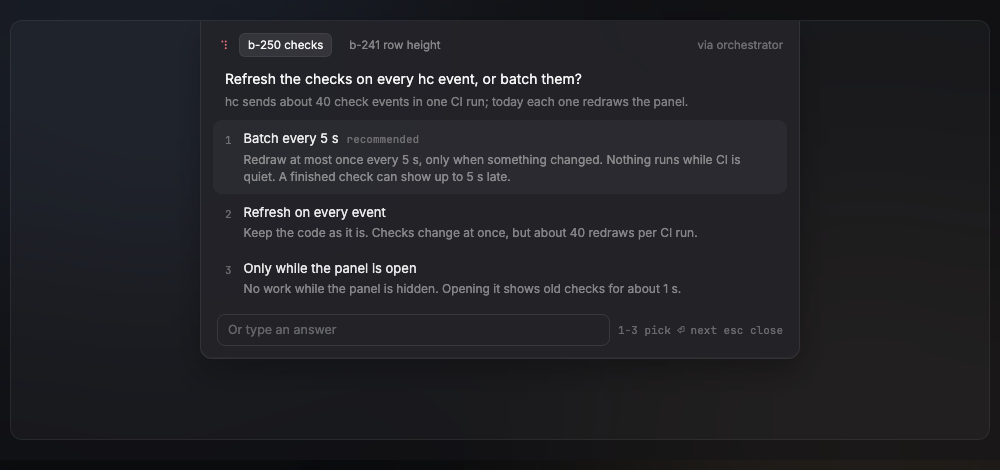
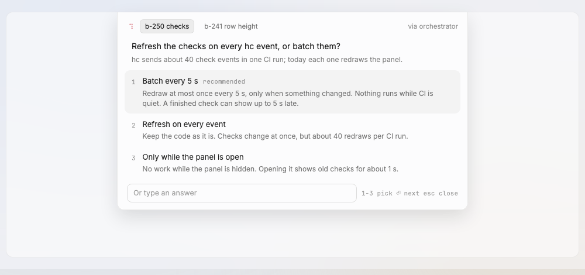

# QuestionsCard

The open notch: one question at a time with its choices, a recommended choice, and a field for a free answer. To-dos and blocked worker menus are more chips after the questions.

Design system page: component QuestionsCard. Shared rules: [README.md](README.md).

| Dark | Light |
|---|---|
|  |  |

## Anatomy

Width `notch-open-width` (600px), padding `space-12`, glass as the notch.

1. **Head:** needs-you glyph; one chip per open question, then one chip per to-do and per blocked worker menu (D124) ("b-250 checks", `chip` 11.5px, padding `3px 9px`, radius `radius-6`); "via orchestrator" at the right (`ink-35`).
2. **Question:** `question` style (14/20), `ink-100`, padding `2px 12px`.
3. **Context:** `small` (12/17), `ink-42`.
4. **Choices:** each a row, gap `space-12`, with a mono number (11px, `ink-32`), a label (`body`, `ink-90`), an optional "recommended" tag (mono 11px, `ink-32`), and its impact under it (below). An option has no other description: the owner file holds a label and, for each, an impact. Row padding `9px 12px`, radius `radius-9`. The impact of the option (D114) shows under the label, in `small`, `ink-42` (D125).
5. **Field:** "Or type an answer", height 30px, line `input-line`, radius `radius-8`, placeholder `ink-30`.
6. **Details:** a collapsible section "Details", closed at first, with the refs and the source excerpt (D114) in `small`, `ink-42`. It shows only when the question has refs or a source (D125).
7. **Keys:** mono 11px, `ink-32`, by item: a question "1-3 pick  ⏎ send  ⇥ next  esc close"; a to-do "⏎ done  ⇥ next  esc close"; a blocked menu "1-3 send  ⇥ next  esc close". A blocked menu takes no ⏎, so a stray key never approves a permission (D51). The line shows no ⇥ when there is one item.

## States

- **Chip on:** fill `selected`, ring `shadow-selected`, text `ink-100`; other chips `ink-45`.
- **Choice hover:** fill `hover`.
- **Choice picked:** fill `hover` (the same as hover); the keyboard moves it.
- **Answered:** the card moves to the next question; with none left, the notch hides.

## Behavior

- One question at a time; the chips switch between open questions.
- ⏎ sends the typed text, else the picked choice, else the recommended one.
- The answer goes to the coordinator that asked (D36, D108). The card
  moves to the next question; with none left, it closes and the notch
  hides.
- Option impacts, refs and source (D114) show in the card (D125). There is no
  `⌘J` sheet: `⌘J` opens and closes the card.
- A to-do chip shows the to-do text. A blocked
  worker chip shows the question and the choices of the worker's menu (D51);
  the answer is sent to the worker's terminal (D124). The chips are in this
  order: questions, to-dos, blocked menus (D140). The card opens on the first
  question when there is one.
- A blocked menu takes no ⏎: only `1`–`9` or a click on a choice sends, so a
  stray key never approves a permission (D51).

## Data

- `internal/owner` read and answer, on a goroutine.

## Keys and focus

- `1`–`9` pick, ⏎ send and next (not on a blocked menu), ⇥ next chip, Esc close (focus in the card only).

## Edge cases

- Send fails: keep the card open and show the error under the field.
- A question answered elsewhere: drop it from the chips.
- More than 9 choices: keys pick the first 9.

## Accessibility

- Dialog named by the question; choices are radio buttons; the field is labeled "Or type an answer".

## Tokens

`notch-open-width`, `glass-float`, `float-line`, `shadow-notch`, `selected`, `shadow-selected`, `hover`, `input-line`, `radius-9`, `radius-8`, `radius-6`, `question`, `body`, `small`, `chip`, `ink-100`, `ink-90`, `ink-45`, `ink-42`, `ink-35`, `ink-32`, `ink-30`.

## Build in MyGo

- `PopoverBase` anchored to the notch: it keeps Escape, focus return and the automation hooks.
- Details: `CollapsibleBase`.
- Chips: `SegmentedBase`. Choices: `SelectBase` or a list of `ButtonBase` rows with role radio.
- Field: `TextInputBase`.
- Keys with `c.Shortcut(...)`: 1–9 pick, ⏎ send and go to the next, ⇥ next chip, Esc close.
- Send the answer with the owner package (`internal/owner`) on a goroutine.

## Do and do not

**Do**

- Put the recommended choice first.
- Keep impacts to one or two lines that say the effect.

**Don't**

- Do not open the card by itself: the owner opens it.
- Do not use red in the card: the glyph is enough.

## Tests

- View: pick by key, send typed text, Esc closes, next question shows.
- View: impacts show under their options; "Details" opens and closes, and hides when there are no refs or source.
- View: to-do and blocked worker chips show after the questions.
- View: send error stays and shows.
- e2e: answer a question on a scratch core and see the notch hide.

## Replaces

- `answercard.go` and `cardparts.go` (answer card, D44). `cardbutton.go` keeps the button parts the needs row still uses.
