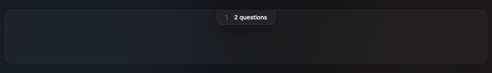
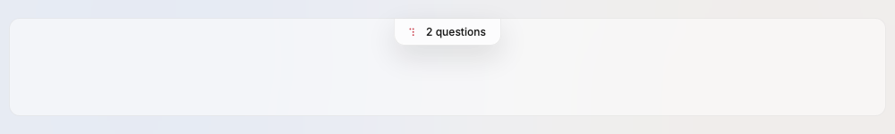

# QuestionsNotch

A small glass tab that hangs from the top of every terminal of the project while an agent asks the owner a question or something else needs the owner; click opens the questions card.

Design system page: component QuestionsNotch. Shared rules: [README.md](README.md).

| Dark | Light |
|---|---|
|  |  |

## Anatomy

| Part | Value |
|---|---|
| Box | height `notch-height` (30px), padding `0 16px 0 12px`, gap `space-9`, radius `0 0 radius-12 radius-12` |
| Glass | `glass-float`, blur `glass-blur`, line `float-line`, shadow `shadow-notch` |
| Dot | 8px circle, `blocked`, 3px at each side (it takes the 14px of the small glyph); label "needs you" (D240) |
| Glow | after an arrival only: a 1px ring in `blocked` at 0.6 and a shadow `0 0 18px 3px` in `blocked` at 0.42, fading out (D240) |
| Label | 12px, `ink-100`: "1 question", "2 questions"; with to-dos or blocked menus, "3 items"; "1 item" for one to-do or menu alone (D124, D135) |

## States

- **Hidden:** no open questions, to-dos or blocked menus.
- **Closed:** as above.
- **Arrival (D240):** the count of open items of the project goes up. The
  notch springs once from its top center (scale 1.06 at 120 ms, 0.985 at
  260 ms, 1 at 400 ms) and the glow comes in 80 ms and fades out by 2.08 s.
  After the spring the dot pulses 5 times on a 2 s cycle (10 s): to opacity
  0.3 and scale 0.8 and back, ease in and out. Then it is still.
- **Waiting:** after the pulse the dot is solid `blocked`. Nothing moves, so
  no frame is asked (D55).
- **Open:** see QuestionsCard.

## Behavior

- Shows while the project has at least one open question, to-do or blocked
  worker menu, at the top center of each terminal of the project.
- To-dos (`do`, `know`) and the menu of a blocked worker (D51) are more
  chips after the questions, in the card (D124). The count in the label
  covers all of them.
- Click or `⌘J` opens the QuestionsCard.
- Worker questions reach the owner through the orchestrator.
- Attention (D240): a new item (the count goes up) starts the arrival
  effect. A new item during the effect starts it again from the start. The
  count going down, opening the card and closing it start nothing; an item
  that comes while the card shows starts nothing either, as the card shows
  it. Counts are kept per project: the first items of a project, or more
  items than when the project last showed, are an arrival.
- Reduce Motion (`Preferences().ReduceMotion`): no spring, no glow, no
  pulse; the still dot shows at once.

## Data

- `internal/owner` (questions file), watched with `mygo.WatchFiles`; read on a goroutine.

## Keys and focus

- `⌘J` opens and closes the card. Space and ⏎ when focused. While ⌘ is held, a `J` key chip shows on the dot (KeyHints.md).

## Edge cases

- Questions, to-dos and blocked menus of another project: not counted here.
- The questions file is broken (unreadable or locked): the model logs the error once (D135) and the notch shows "Questions file unreadable" in `blocked`, in the same place and in every terminal of the window, with the error in a tooltip and no click (D146). The card closes. It goes when the file reads again.

## Accessibility

- Label: "2 questions. Open". With to-dos or blocked menus: "3 items. Open".

## Tokens

`glass-float`, `float-line`, `shadow-notch`, `notch-height`, `radius-12`, `blocked`, `ink-100`, `label`.

## Build in MyGo

- `ButtonBase` in the terminal overlay; glass from `Material(glass.Blur{...})` under a `glass-float` fill (glass plugin, D135).
- It shows in each terminal of the project, orchestrator and workers alike, so the owner can answer from any of them.
- Data: `internal/owner` (questions file), through the agent state (`agentstate`), which watches it and reads on a goroutine (D135). A worker question reaches the owner through the orchestrator.
- Shortcut: ⌘J opens the card.
- Attention: `kit.Arrivals` tells an arrival; `kit.NotchAttention` plays it
  with MyGo `Keyframes` on the notch button, which stays while the card
  shows. The view asks for the keyframes only while the effect plays, so no
  frame is asked after it (D240).

## Do and do not

**Do**

- Say the count in words: "2 questions".

**Don't**

- Do not show the notch when nothing needs the owner.
- Do not animate the notch in a loop: it moves only for 10 s after an
  arrival (D240), then it is still.

## Tests

- View: hidden at 0, "1 question", "2 questions".
- View: a to-do and a blocked menu count with the questions ("3 items").
- View: shows in an orchestrator and a worker terminal of the same project.
- View: an arrival springs the notch and pulses the dot; no frame is asked
  after the effect; a lower count, the card and an item of another project
  start nothing; a second arrival starts it again; Reduce Motion shows only
  the still dot (D240).

## Replaces

- The question tabs of the v0.2 bottom row (D69).
