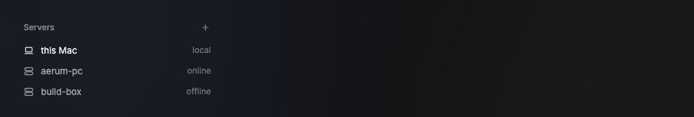
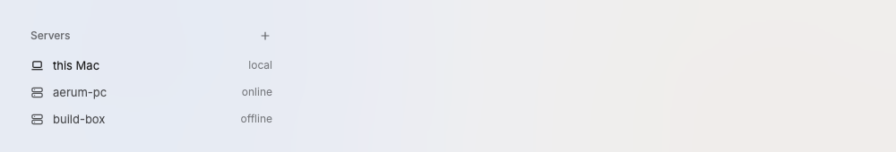

# ServerRow

A sidebar row for one machine that runs hc: this Mac, or a remote server.

Design system page: component ServerRow. Shared rules: [README.md](README.md).

| Dark | Light |
|---|---|
|  |  |

## Anatomy

| Part | Value |
|---|---|
| Row | as ProjectRow: `row-height`, padding `0 10px`, gap `space-10` |
| Icon | `computer` (this Mac) or `server`, 15px, `ink-100` when selected (the icon sets its own ink, D171) |
| Name | `body`, `ink-60` |
| Meta | `small` (12px), `ink-38`, right: "local", "online", "offline" |

## States

- **Selected:** the machine whose projects the sidebar shows: name and icon `ink-100`, no fill.
- **Online, local:** as above.
- **Offline:** the meta says "offline"; the row stays clickable to retry.

## Behavior

- The Servers section is at the bottom of the sidebar, under the project
  list and above the Settings button (screens 1 to 5). Only this Mac shows,
  under the heading "Servers" (O11 settled, D132; remote servers wait for
  #149). Its meta is "local".
- The row of this Mac also shows its CPU and memory use (D126). They sit in
  the meta, in `ink-38`, and use no new color: "local · 12% CPU · 48% MEM".
- Click selects the machine; the projects under it are its projects.
- `+` in the head is hidden until #149 (D132). The Settings button (D146, moved by D147) is not in this head: it is at the bottom right of the sidebar, under a hairline below the project list and the Servers section, with the plan meters at the left of the same row (D189, UsageMeter.md) (the gear icon, tooltip "Settings  ⌘,", a small `ink-100` dot at its top right corner while an update waits, label "Settings, update ready"). The icon column shows it at the bottom of the column. `⌘,` also opens Settings.

## Data

- hc connection state from `internal/hc` (connected, problem). No polling.
- CPU and memory: the source of the v0.2 host card (D113), read on a
  goroutine; the result reaches the row through `Window.Update`.

## Keys and focus

- ↑ ↓ in the sidebar list.

## Edge cases

- hc not reachable: meta "offline", the problem line under the row (as D113).

## Accessibility

- Label: "This Mac, local".

## Tokens

`row-height`, `hover`, `ink-100`, `ink-60`, `ink-38`, `small`.

## Build in MyGo

- `kit.Row` in a `ui.List` under a panel head "Servers" with an Add icon button.
- Online state comes from the hc connection (`internal/hc`); do not poll in the view.

## Do and do not

**Do**

- Name this computer "this Mac".

**Don't**

- Do not use green for online or red for offline: text says it.

## Tests

- View: local, offline states; the problem line shows when hc fails.

## Replaces

- The `This computer` header of `spaces.go` (D113).
