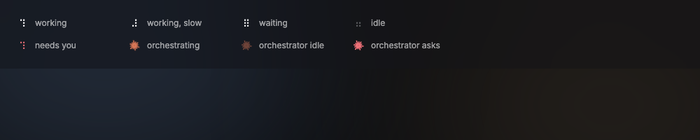
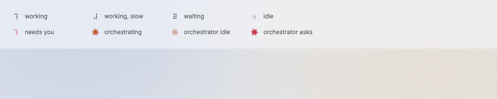

# StatusGlyph

A one-character mark that tells the state of an agent: a braille spinner for workers and terminals, and the Claude glyph for the orchestrator.

Design system page: component StatusGlyph. Shared rules: [README.md](README.md).

| Dark | Light |
|---|---|
|  |  |

## Anatomy

- Braille glyph: mono `glyph` style (17/18), 16px wide; 14px inside tabs and the notch.
- Claude glyph: 16px icon of the official Claude mark in `claude`. The mark is one filled shape (`assets/icons/claude.svg`, D123), so "stroke" below means its color.

## States

| State | Braille | Claude glyph | Means |
|---|---|---|---|
| working | ⠋⠙⠹⠸⠼⠴⠦⠧⠇⠏ every 90ms (cycle .9s), `ink-100` | turns once in 2.4s | the agent runs |
| working, slow | same, cycle 1.4s | — | no output for a while |
| waiting | ⠿ fades .25↔1 in 1.6s | — | waits for CI or another agent |
| idle | ⠶ still, `ink-30` | still, opacity .45 | nothing to do |
| needs you | spinner in `blocked`, still on ⠋ | mark in `blocked` | asks the owner a question or is stuck at a prompt |

With reduce motion on, every glyph is still: working shows ⠋, waiting shows ⠿.

## Behavior

- One glyph per agent. The state comes from the agent state (D35): working,
  working slow (no output for a while), waiting, idle, needs you.
- Needs you wins over every other state.
- The Claude glyph has no motion for working slow and waiting: it is still at full opacity.
- Small (tabs and the notch) is 14px; rows are 16px.

## Data

- `internal/agents` watch events; the view only maps state to glyph.

## Keys and focus

- None.

## Edge cases

- Off screen: the timer stops.
- Reduce motion: still glyphs (⠋ working, ⠿ waiting).

## Accessibility

- Label: "working", "waiting", "idle", "needs you".

## Tokens

`glyph` type style, `ink-100`, `ink-30`, `blocked`, `claude`.

## Build in MyGo

- A small custom widget (see `ui/custom-widgets.md`; `kit.StatusGlyph`) that draws one text glyph (a shaped `ui.TextLayout` in the mono family). A timer changes the frame only while the state is working or waiting and the glyph is on screen; idle and needs-you states use no timer, so the app uses no CPU while idle.
- Read the reduce-motion setting from MyGo and stop the timer when it is on.
- Claude glyph: the official Claude mark (D123, `assets/icons/claude.svg`), drawn with `Painter.Icon` and turned with `Painter.Transform`. `.Transition(...)` and `AnimatePose` go to a target and stop, and the turn repeats, so the mark paints itself from `Draw`, as the working icon of `internal/app/icons` does. Like the braille glyph, it asks for repaints only while it works, so it stops off screen and with Reduce Motion.
- Braille frames repaint at the step boundary (`Painter.After`), a fade and the turn at 30 frames a second.
- Give the glyph a screen-reader label: "working", "waiting", "idle", "needs you".

## Do and do not

**Do**

- Use red only for "needs you".
- Keep one glyph per row, tab or chip.

**Don't**

- Do not use a spinner from MyGo here: the braille glyph is part of contr's look.
- Do not use amber or green for states in the chrome.

## Tests

- Unit: state to glyph and frame list.
- View: no timer runs for idle and needs you; reduce motion stops it.

## Replaces

- The status icons in `assets/icons` used by rows and tabs (v0.2 Status icons).
