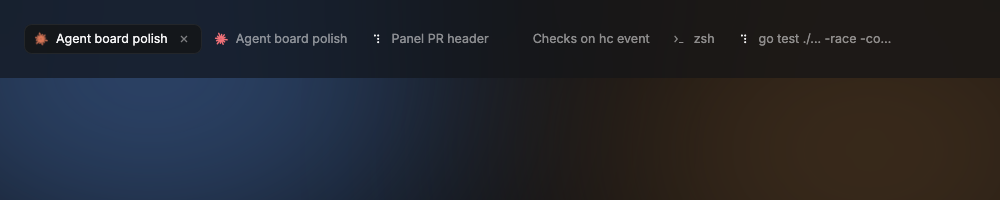
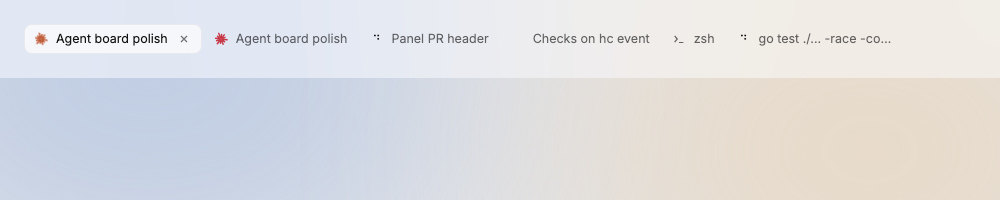

# Tab

A tab is one hc terminal of the selected agent: a status glyph, a title clipped with an ellipsis, and a close button on the selected tab.

Design system page: component Tab. Shared rules: [README.md](README.md).

| Dark | Light |
|---|---|
|  |  |

## Anatomy

| Part | Value |
|---|---|
| Box | height `row-height` (30px), padding `0 10px`, gap `space-8`, radius `radius-8`, max width `tab-max-width` (180px); tabs sit `space-2` apart |
| Leading | StatusGlyph at 14px, Claude glyph, or the terminal icon at 14px |
| Title | `row-small` (12.5px), `ink-50`; one line, ellipsis |
| Close | 16px box, radius `radius-4`, 10px `close` icon in `ink-45`; only on the selected tab |

## States

- **Default:** no fill, title `ink-50`.
- **Hover:** fill `hover`.
- **Selected:** fill `panel` and a 1px inset `panel-line` edge, as the panels (D164); title `ink-100`, close button shows.
- **Close hover:** fill `press`, icon `ink-100`.
- **Blocked agent:** the glyph turns `blocked`; the tab is not otherwise colored.

## Behavior

- Click selects the tab: the terminal shows its hc terminal.
- The close button shows on the selected tab only. On an agent's own
  terminal the close button is hidden (D85): stop an agent from its row's
  menu.
- The title is the terminal title (OSC), else the agent name, else
  `$ <folder>`.

## Data

- hc terminal title and the agent state from `internal/agents`.

## Keys and focus

- `⌘W` closes a plain terminal tab. Arrows move between tabs (`TabsBase`).
- Middle-click closes a plain terminal tab; an agent tab ignores it (D85, D142).
- Context menu: Close (plain terminal only; off on an agent tab) and Close
  others (every plain terminal except this tab; an agent never closes).
  There is no Rename: hc cannot store a name for a terminal (D142).
- Drag a plain terminal tab onto another to take its place. The agent's own
  tab stays first and does not drag. The order lasts for the session (D142).

## Edge cases

- A title longer than 180px: ellipsis.
- The terminal ends: the tab closes (D112).

## Accessibility

- Role tab, selected state, label = the title; close button label "Close tab".

## Tokens

`panel`, `panel-line`, `hover`, `press`, `ink-100`, `ink-50`, `ink-45`, `row-height`, `radius-8`, `radius-4`, `space-8`, `space-2`, `tab-max-width`.

## Build in MyGo

- `TabsBase` with a custom tab view. The title is `Text(...).NoWrap().Ellipsis()`.
- Close button: `ButtonBase` with the `close` icon, label "Close tab".
- Middle-click (`HandleInput`, button 2) and ⌘W close the tab. Reorder with `Drag` and `Drop` on the tab.
- Context menu (`.ContextMenu(...)`): Close, Close others. Rename waits for an hc name call (D142).

## Do and do not

**Do**

- Use the process name ("zsh", "go test ./...") when the terminal has no title.

**Don't**

- Do not show more than one close button at a time.
- Do not use the accent color for the selected tab.

## Tests

- View: each state (default, selected, blocked glyph).
- View: close on a plain terminal tab; no close on an agent tab.
- View: middle-click, menu and drag never close or move an agent tab.

## Replaces

- The tab parts of `titlebar.go` and `agenttabs.go`.
