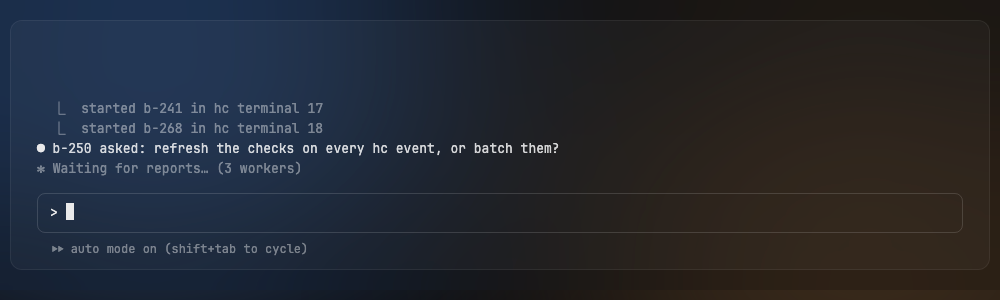
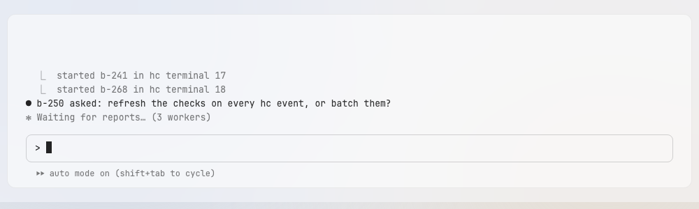

# Terminal

The terminal panel shows the hc terminal of the selected tab; it fills the space between the sidebar and the files panel.

Design system page: component Terminal. Shared rules: [README.md](README.md).

| Dark | Light |
|---|---|
|  |  |

## Anatomy

| Part | Value |
|---|---|
| Panel | Panel with padding 0 |
| Text | mono `terminal` (13/20), `terminal-text`; dim lines `ink-42`; padding `18px 26px 10px`; text sits at the bottom |
| Overlays | QuestionsNotch at the top center, Outline at the right edge (orchestrator only) |

## States

- **Focused:** the cursor blinks; keys go to the terminal.
- **Not focused:** the cursor is a hollow box.
- **Process ended:** a last line in `ink-38`; the tab closes on stop.

## Behavior

- Shows the hc terminal of the selected tab (D80). contr watches until the
  owner types; the first key sizes the terminal (D91).
- The background is clear over `panel`; the text color is
  `terminal-text`; the ANSI palette is the theme's (README Themes). The
  Light palette is a known light palette tuned for contrast on the light
  panel (D129). The 16 colors and their contrast ratios are in
  [tokens.md](tokens.md), ANSI. The plugin draws solid colors, so contr gives
  it `terminal-text` and `panel` flattened over the ground (D133).
- The overlay layer (`TerminalOverlay` in `internal/app`) builds nothing
  while no overlay is set. A layer draws small floating elements placed with
  `Absolute`; it never covers the grid, so the terminal keeps the pointer and
  the keys. A layer gets keys only while one of its elements has the focus.
- Overlays: QuestionsNotch in every terminal of a project with an open
  question, to-do or blocked worker menu (D124); Outline in the orchestrator terminal only.

## Data

- `internal/app/ghostty` `Conn` over hc.

## Keys and focus

- Keys go to the terminal while it has the focus. Esc is never taken by contr.
- `⌘F` opens MyGo's `FindBar` over the terminal text (D130). Esc in the
  `FindBar` closes it, ends the search and returns the focus to the terminal.
  `⌘F` while the bar shows gives its field the focus again. There is no split.
- The `FindBar` takes keys only while it shows; a closed bar builds nothing.
  Its Enter, Shift+Enter, `⌘G` and `⇧⌘G` go to the next and the previous
  match; the plugin's `SearchNext` and `SearchPrevious` select it.

## Search

- The plugin searches (D143): `Terminal.Search` reads the terminal's own
  screen and scrollback, highlights every match, selects the newest and
  scrolls to the selected one, clear of the bar. It goes through a long
  scrollback in the frames after, a few milliseconds each, so the UI thread
  does not block. Nothing goes to hc.
- The bar's count is the plugin's status (`OnSearch`): "1 of 3" counts from
  the newest match; "No matches" shows for a query with none.
- The bar sits at the top right of the terminal, in the overlay layer; it is
  a `FindBar` with the glass-float look.
- Matches are `press` over the panel; the selected match is `ink-95` with panel
  text. The plugin's amber and orange are replaced (D143).
- Selecting another terminal closes the bar.

## Edge cases

- No selection: "select an agent to see its terminal" in `ink-42`. At launch the app selects
  the first live orchestrator in sidebar order, else the first live worker, so this line shows
  only when nothing is live, or after the owner clears the selection (D173).
- The process ends: a last line in `ink-38`.
- Theme change: the palette changes without a reconnect.
- The text sits at the bottom: the first key sizes the terminal to the panel
  (D91), so the grid fills the padded area. Until then the grid keeps the
  core's size, at the top left.

## Accessibility

- Label: "Terminal, <agent>".

## Tokens

`terminal`, `terminal-text`, `ink-42`, `ink-38`, `ink-95` (cursor, selected search match), `press` (search matches), `ansi-*`, `space-18`, `space-26`, `space-10`, `panel`.

## Build in MyGo

- MyGo's terminal plugin (`docs/plugins/terminal.md`) with `internal/app/ghostty`'s `Conn` as the connection to the hc terminal.
- Set the terminal colors from the tokens: background transparent over `panel`, foreground `terminal-text`.
- Put the notch and the outline in an overlay layer above the terminal; they must not take keys from it unless focused.

## Do and do not

**Do**

- Keep the terminal background transparent so the glass shows.

**Don't**

- Do not draw a border around the prompt in the app: the shell draws it.

## Tests

- View: palette per theme; overlays do not take keys.
- View: `⌘F` and the Search button show the `FindBar` over the terminal; typing
  finds the matches of a fake terminal text; Enter and Shift+Enter go to the
  next and previous match; Esc closes the bar and the terminal gets the
  focus back; a closed bar takes no key.
- e2e: type in a scratch core terminal and read the text back.

## Replaces

- The v0.2 terminal card and its 34 header (not built).
