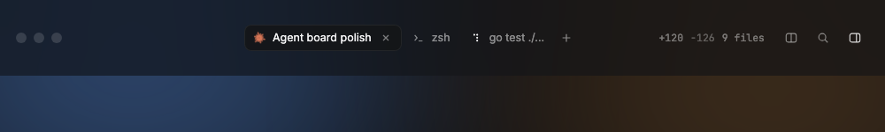
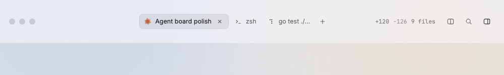

# TitleBar

The title bar holds the traffic lights, the tabs of the selected agent, the update pill, the diff summary and three icon buttons; it is also the drag area of the window.

Design system page: component TitleBar. Shared rules: [README.md](README.md).

| Dark | Light |
|---|---|
|  |  |

## Anatomy

From left to right:

1. Traffic-light area, as wide as the sidebar plus its gap (328px with the default sidebar), so the tabs start above the terminal. It holds only the window buttons: there is no sidebar button next to them (D172). With the sidebar hidden or as icons, the area is 78px, so the tabs stay clear of the window buttons.
2. Tabs (see Tab) and a "New tab" icon button.
3. Flexible space (drags the window).
4. UpdatePill (see UpdatePill), only while an update is ready (D176).
5. DiffSummary of the selected project.
6. Icon buttons: Search, Hide files (pressed while files show).

Height `titlebar-height` (46px: a 30px tab, 8px above and below, D177; the panels start right under it), gap `space-8`, right padding `space-14`. Items center on the vertical axis.

## States

- The tabs follow the selected agent row in the sidebar: the agent's own
  tab first, then the plain terminals of its project (D131). Selecting a
  plain terminal keeps the last agent.
- DiffSummary hides when the project has no changes.
- UpdatePill shows from the end of a background install until the restart (D176).
- Hide files is pressed (`aria-pressed`) while the files panel shows.

## Behavior

- The tabs are the hc terminals of the agent selected in the sidebar
  (orchestrator or worker), plus its plain terminals.
- `+` (New tab) opens a plain terminal in the folder of the selected agent
  (D82).
- DiffSummary counts the selected project.
- Search opens MyGo's `FindBar` over the terminal text (D130). There is no
  Split button: split is dropped for now.

## Data

- Tabs: `internal/agents` and the hc terminal list, through `Window.Update`.
- Diff counts: see DiffSummary.

## Keys and focus

- `⌘T` new tab, `⌘W` close tab (plain terminals only, D85), `⌘F` search, `⌘⇧E` files, `⌘B` show or hide the sidebar (D172).
  `⌘T` and `⌘W` are the File menu items, which hold the key (D131); `⌘B` is the
  View menu item "Toggle Sidebar"; `⌘⇧E` is `c.Shortcut`.
- The tooltips show each key.

## Edge cases

- No agent selected: no tabs; `+` still shows.
- Many tabs: tabs shrink to their min width, then the row scrolls.

## Accessibility

- The tab row is a tab list; each button has a label and a tooltip.

## Tokens

`titlebar-height`, `space-8`, `space-14`, `ink-*` through its children.

## Build in MyGo

- Draw the bar in the view; mark the empty parts as the window drag area so the window moves and a double-click zooms.
- Tabs: `TabsBase` (keeps arrow keys, focus and the automation hooks).
- Buttons: IconButton (`ButtonBase`).
- Shortcuts: new tab (⌘T) and close tab (⌘W) are File menu items; search (⌘F) and files (⌘⇧E) are `c.Shortcut(...)`. Show them in the tooltips.

## Do and do not

**Do**

- Keep the tabs aligned with the left edge of the terminal panel.

**Don't**

- Do not put a window title or a project name in the bar: the sidebar shows them.

## Tests

- View: selecting another agent changes the tabs.
- View: `+` opens a plain terminal (fake hc); `⌘W` closes a plain terminal
  tab and ignores an agent tab.
- View: Hide files is pressed while the files panel shows.
- View: Search sits left of Hide files, shows "Search  ⌘F" and opens the
  find bar.

## Replaces

- `titlebar.go` and the top bar of `frame.go` (D50 tabs of the open project).
