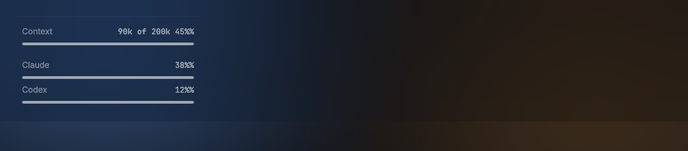
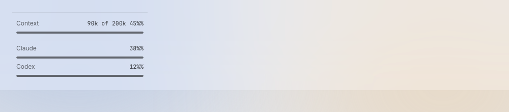

# UsageMeter

The info block at the bottom of the files panel shows the context of the selected agent. The plan meters (how much of each plan is used) are in the sidebar foot, left of the Settings button (D196).

Design system page: component UsageMeter. Shared rules: [README.md](README.md).

| Dark | Light |
|---|---|
|  |  |

## Anatomy

| Part | Value |
|---|---|
| Block | no line on top (D258), padding `12px 10px 2px` (D228), gap `space-7`; `space-6` more before each meter after the first |
| Row | label `small`, `ink-42`; value mono `value`, `ink-62`, at the right |
| Meter | height `meter-height` (4px), track `meter-track`, fill `meter-fill`, radius `radius-2` |

Rows: "Context  90k of 200k  45%" only.

Plan meters, in the sidebar foot row (D196):

| Part | Value |
|---|---|
| Group | one row, inline, gap `space-7`; `space-6` more between two plans |
| Label | `small`, `ink-42` |
| Meter | width 44px, the meter above |
| Value | mono `value`, `ink-62` |

"Claude ▬ 38%  Codex ▬ 12%", then free space, then the Settings button. The foot has padding `space-10` left and right, so the meters and the button have the same inset; no divider is above it (D258): the foot has `space-6` on top, and the row has `space-6` above and below (D201).

## States

- **Default.**
- **Above 80%:** not in the design. Keep `meter-fill`; the number says it.
- **No data:** the value shows "no data yet" in `ink-42` (D255; a dash before). Under the
  file tree the meter is empty; in the sidebar foot the plan has no meter, only its label and
  "no data yet".

## Behavior

- Under the file tree: Context of the selected agent.
- Sidebar foot: one meter per plan (Claude, Codex), as percent used. Plan
  usage is global, so it does not follow the selection (D196). The icon
  column (D128) has no room: it shows only the Settings button.

## Data

- Context (D144): `contr statusline` saves the tokens and window size of an
  agent in `usage/context/<HC_TERMINAL_ID>.json`. The sampler reads the folder
  with the plans. The line shows the file of the selected orchestrator, worker
  or plain terminal as "90k of 200k  45%", and the meter fills to that percent.
  The context is up to one sampler period (60 s) old.
- Context fallback (D205): when the terminal has no file, the line uses the
  labels that the kit's Stop hook puts on the terminal after each turn:
  `contr.context` (tokens) and `contr.context-limit`. That limit is the
  compaction window (the size where Claude Code compacts), not the model's
  window, so the percent is of the compaction window: "90k of 160k  56%".
  A label that is missing or not a positive integer is no data. The labels
  are as old as the last turn.
- No file and no labels, no selection or a worktree row: "no data yet" and an
  empty meter (D255).
- Plans: `internal/usage` on a goroutine; read again on a status line or log
  change. The view reads the sampler's last result and touches no file.
- Claude plan (D203): Claude Code gives the plan limits (`rate_limits`) only
  to its status line command. Each Claude session that contr starts (workers
  and "New orchestrator") gets `--settings` with a `statusLine` that runs
  `<contr> statusline`. That command saves the windows to `usage/claude.json`
  and the context, and prints a short line ("opus · 90k of 200k"). A Claude
  session that contr did not start gives plan data only when the owner's own
  status line runs `contr statusline`.
- Codex plan (D210): contr starts `codex app-server` (JSON-RPC over stdio,
  one JSON message per line), sends `initialize`, the `initialized`
  notification and `account/rateLimits/read`, then closes stdin and waits for
  the process to end. The `codex` limit (`rateLimitsByLimitId.codex`, else
  `rateLimits`) gives the windows: `primary` and `secondary`, `usedPercent`
  and `resetsAt` (Unix seconds). A read that takes more than 10 s is killed.
  contr reads no Codex file for this. `codex` comes from PATH, else from the
  PATH of the owner's interactive login shell (read once per run), so an app
  opened from Finder finds it too. No `codex`, an error answer (not logged in),
  a bad answer or a timeout gives no data and is logged once per kind until a
  read succeeds. Then the newest rollout file under `sessions/` is read, for
  older Codex versions.

## Keys and focus

- None.

## Edge cases

- No data: "no data yet" (D255). The Context line keeps an empty meter; a plan in the
  sidebar foot drops its meter.
- Narrow sidebar: a plan that does not fit whole hides (it wraps to a clipped second line);
  the Settings button stays (D255).

## Accessibility

- Meter role with value 0–100 and a label.

## Tokens

`meter-track`, `meter-fill`, `meter-height`, `radius-2`, `space-7`, `ink-42`, `ink-62`, `small`, `value`.

## Build in MyGo

- `ui.Meter` for each bar (role meter, value 0–100). Style it with the tokens.
- Data: `internal/usage` (Claude status line, `codex app-server`, Codex logs).

## Do and do not

**Do**

- Show whole percents.

**Don't**

- Do not color the meters red or amber.

## Tests

- View: values, no data, 100%; the file wins over the labels; labels without a file.
- The files panel has only Context; the sidebar foot has Claude, then Codex, then the gear, in one row; the icon column has no plan meters.

## Motion (D256)

A value rolls its changed digits in `motion-number`; a fill moves to its width in `motion-meter`. With Reduce Motion the value cross-fades and the fill is at once. See [Motion.md](Motion.md).

## Replaces

- The plan bars of the v0.2 footer (`statusbar.go`).
