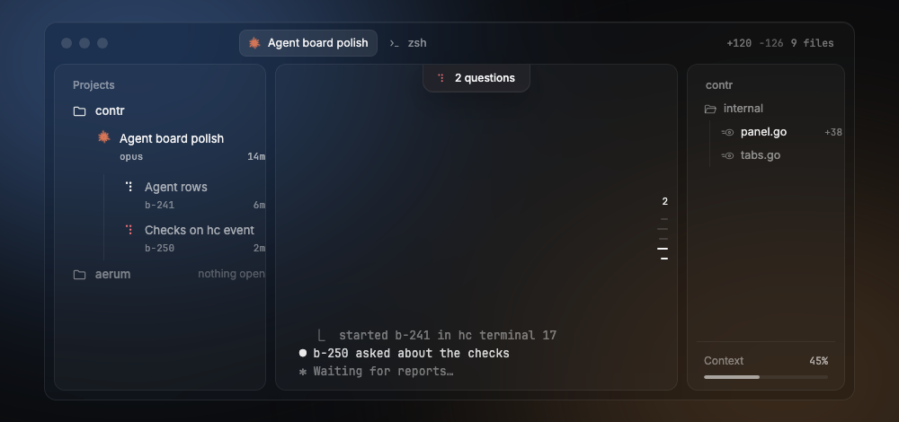
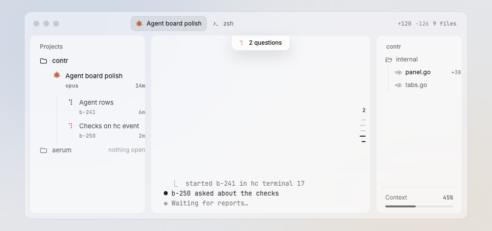

# Window

The contr window is one glass sheet over a dark ground: a title bar on top, then three panels in a row (sidebar, terminal, files).

Design system page: component Window. Shared rules: [README.md](README.md).

| Dark | Light |
|---|---|
|  |  |

## Anatomy

| Part | Value |
|---|---|
| Ground | `ground` with three soft glows (`glow-slate`, `glow-umber`, `glow-graphite`) behind the glass |
| Glass sheet | `glass-window`, blur `glass-blur`, saturate `glass-saturate`, radius `radius-14`, border `window-line`, inner top line `shadow-window-top` |
| Title bar | `titlebar-height` (46px), see TitleBar |
| Body | row of panels, gap `space-10`, padding `10px` on every side: the gap under the title bar, to the left, right and bottom edge, and between the panels are all `space-10` (D167) |
| Panels | sidebar `sidebar-width` (312px), terminal (fills), files `files-width` (280px) |

## States

- **Default:** three panels.
- **Files hidden:** the files toggle in the title bar removes the right panel; the terminal grows.
- **Inactive window:** macOS greys the traffic lights. Nothing else changes.

## Behavior

- The window opens at the visible frame of the screen (menu bar and Dock excluded), inset 20px on every side, and at least 640 x 600 (D167). It does not keep the last size yet. The sidebar and files widths are the
  ones the owner dragged (D111), else the defaults here.
- Limits: sidebar 200–480 (D111), files 220–720. The terminal keeps at least
  480.
- The files toggle (`⌘⇧E`, the title bar button) hides and shows the files
  panel. A hidden panel keeps its width.
- Narrow window (D128): below about 1100px the files panel hides. Below
  about 800px the sidebar collapses to an icon column, 56px wide (D141). The terminal keeps its
  minimum width: above 1100px the files panel gives way first, down to
  220, then the sidebar, down to 200. The stored widths do not change.

## Data

- Widths: `internal/widths` (read at start, written on drag end).
- Theme: `mygo.Theme` (see README Themes).

## Keys and focus

- `⌘⇧E` files panel. Other keys: README Keys.
- Tab order: sidebar, terminal, files panel.

## Edge cases

- Window below about 1100px: the files panel hides, and `⌘⇧E` does not show
  it. It returns when the window grows, unless the owner hid it.
- Window below about 800px: the sidebar shows icons only (project and agent
  glyphs, no text); the tooltips keep the names. The rows keep their click,
  context menu and label. A divider drag there does not change the stored
  width (D141).
- Reduce Transparency and Increase Contrast: ignored for now (O13, D138); the glass and inks stay the same.

## Accessibility

- The three panels are groups with the names "Sidebar", "Terminal", "Files".

## Tokens

`ground`, `glow-*`, `glass-window`, `window-line`, `shadow-window-top`, `radius-14`, `space-10`, `titlebar-height`, `sidebar-width`, `files-width`.

## Build in MyGo

- Window: set `Vibrancy` to `VibrancyGlass` (regular glass, frosted: text in windows behind is not readable) so macOS draws the real backdrop blur, and call `SetActiveAppearance(true)` so the glass keeps its look when the window is not the key window (D153, D159). Also set `Transparent: true`: in an opaque window the glass shows only the window's own grey background, not the desktop (D158). The CSS glows only stand in for the desktop behind the window. Do not paint glows in the app.
- Hide the system title bar and draw the title bar in the view (see TitleBar). Keep the system traffic lights.
- Body: a row with `ui.Split` between the panels, so the owner can drag the sidebar and files widths. Store the widths with `internal/widths`.
- Use `Material(...)` (glass plugin, `docs/plugins/glass.md`) only where MyGo needs a material for a floating part, not for each panel.

## Do and do not

**Do**

- Keep 10px between all panels and the window edge.
- Keep the default widths 312 and 280; let the owner drag them.

**Don't**

- Do not add a status bar or a footer to the window (removed, D146). Action messages are toasts at the bottom center, `glass-float` with `float-line`.
- Do not use color on the ground or the glass.

## Tests

- View: widths load from a fake `internal/widths` store; a drag writes them.
- View: `⌘⇧E` hides and shows the files panel; the terminal width grows.
- e2e: open the window on a scratch core in each theme and capture it.

## Replaces

- `frame.go`: the v0.2 frame (top bar, content row, bottom row, footer).
  The bottom row and footer go with the cleanup issue: their parts have a
  place now (D124, D126).
